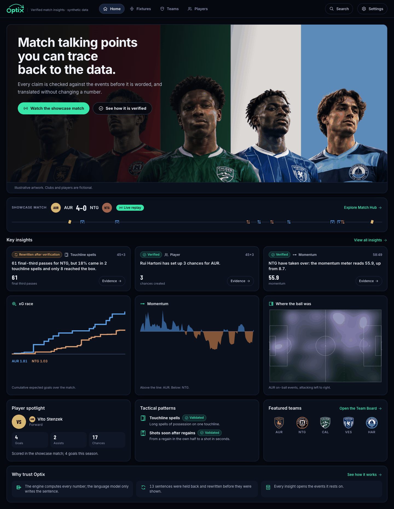
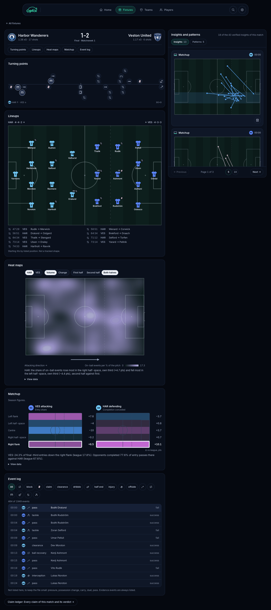
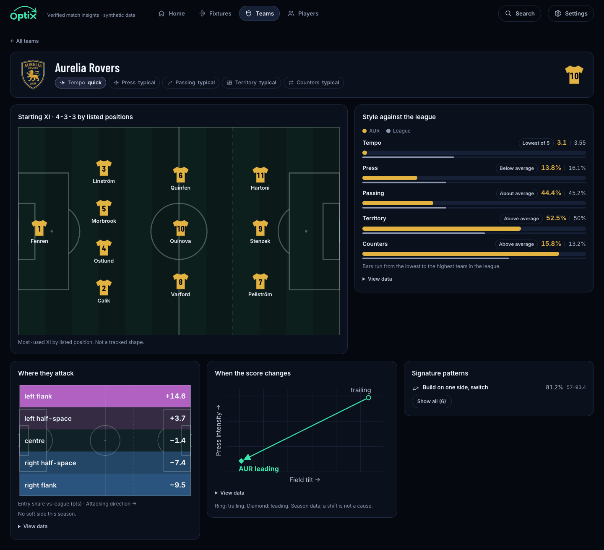

<p align="center">
  <picture>
    <source media="(prefers-color-scheme: dark)" srcset="web/public/brand/optix-logo-accent.svg" />
    
  </picture>
</p>

# Optix

**We explain why a match is unfolding, and we catch stats that are true but misleading.**

Optix is a multi-agent engine that turns synthetic football event data into live talking points, timed overlays and recaps. Every statement is backed by evidence events and checked twice before it reaches the screen:

- **Fact check:** does the event log support the claim?
- **Context check:** is it true but misleading given game state, sample size or metric limits? (For example, high field tilt from a team that is trailing and passing around a deep block.)

**Links:** [Live demo](https://optixweb13588.z28.web.core.windows.net/) · [Code](https://github.com/Malottey1/optix) · [Video](https://youtu.be/fuooZS_4-Xs)

The live demo is an Azure Storage static website in France Central. It serves the replay UI with the committed, template-based data. Live model phrasing (FastAPI plus Azure OpenAI with Microsoft Entra ID) runs from this repo and is not exposed publicly. See [docs/HOSTING.md](docs/HOSTING.md).

<p align="center">
  
</p>

<p align="center">
  
  
</p>

<sub>Screenshots of Home (`#/`), a Match Hub recap (`#/match/m_001`) and a Team Board (`#/teams/AUR`). Synthetic data. The line-up is illustrative, AI-assisted artwork, audited for maker marks (docs/brand-audit.md); the clubs and players are fictional.</sub>

> Status: data generator (small and 20-team league), engine (metrics, effect sizes, xT, flow), Verifier with nine context rules, agents with a block-and-revise loop, timed insight stream in English, Spanish and French, and a dashboard in `web/` (Vite, React, TypeScript: Home, Fixtures, Match Hub with the live replay and final recaps, Team Grid and Team Board, Player Deck and Player Console, Tech Blueprint). See `docs/PROGRESS.md`.

## Who it is for

Fans (second-screen explanations and recaps), broadcasters and studios (trustworthy on-air talking points), and streaming platforms (recaps and overlays at scale). Clubs and leagues own the data; they are not the users.

## Pipeline

| Stage | Component |
|---|---|
| Ingest | Ingest agent and event stream |
| Interpret | Analyst agent: style profiles, matchup vulnerability, xT, momentum |
| Explain | Narrative agent plus Verifier (fact and context check) |
| Render | Timed insight stream, dashboard with Focus Pitch |
| Personalize | engine/personalize.py and its web twin: Fan or Analyst view, followed clubs and players, one focus metric, language; it filters and ranks verified insights and never changes a number (docs/personalization.md) |

## Design principles

1. Numbers are computed deterministically; sentences are filled from templates with already-calculated facts. An optional Azure OpenAI phraser may reword the viewer-facing sentence of an already-verified claim, behind an output guard that falls back to the template (docs/AZURE.md).
2. Claims are verified as language-independent objects, then translated.
3. Everything is explainable: each insight links to the events behind it.
4. Synthetic data only; fictional teams; no real trademarks.
5. Describes the present and past. It does not predict outcomes.

## Repo layout

```
contracts/   JSON Schemas: claim object, insight stream
data_gen/    synthetic data generator
engine/      metrics, style profiles, matchup, momentum, Verifier rules
agents/      Ingest, Analyst, Verifier, Narrative, Personalization agents; orchestrator and Agent Framework
             workflow; guarded phraser; telemetry; audit log; stream; templates
service/     FastAPI: SSE live stream and the built dashboard
infra/       Bicep for Azure Container Apps (build and lint only) and deploy steps
web/         dashboard (current): Vite + React + TypeScript, Tailwind, hand-written SVG; data in web/public/data
app/         deprecated no-build dashboard (reference only; replaced by web/)
tools/       headless dashboard checks (check_web for web/), report generators
legacy/      the first dashboard (deprecated, reference only)
docs/        design notes
tests/       tests
```

See `docs/contracts.md` for how the claim object and insight stream fit together, `docs/data-dictionary.md` for the synthetic data, and `CLAUDE.md` for project rules.

## Quick start (5 commands)

```bash
python3 -m venv .venv && source .venv/bin/activate      # 1. fresh environment (Python 3.10+)
pip install -r requirements-dev.txt                      # 2. jsonschema + pytest, nothing else
python -m data_gen.generate --seed 2026                  # 3. season (data/generated) + showcase match
python -m agents.run_match --match m_showcase --out out/insights.jsonl   # 4. stream the match through the agents
cd web && npm ci --ignore-scripts && npm run dev        # 5. dashboard on http://127.0.0.1:5173/ (Node 20.19+)
```

Optional:

```bash
pip install -r requirements-azure.txt && python -m pytest -q   # tests (workflow, service, telemetry need it; slow ones: -m slow)
python -m engine.report --team AUR --opponent NTG        # style profiles and matchup, as text
python -m agents.personalize --mode casual --lang es --favorite NTG   # personalized feed in the terminal
python -m data_gen.generate --league full                # 20 teams, 380 matches (data/full, ~15 s)
cd web && npm run build && npm run preview               # production build in web/dist, served on :4173
pip install -r requirements-ui.txt && python -m tools.check_web --out docs/screens-v9   # headless gates on every route + screenshots
```

What you get: `out/insights.jsonl` (timed insights, contracts/insight.schema.json), `out/claims.jsonl`
(every verification attempt, including blocked ones), `out/timeline.json` and `out/agent_log.jsonl`
(structured logs), `out/ui.json` (team, player, ledger and report data for the dashboard) and `out/runtime.jsonl` (wall-clock fields: latency per insight, `verified_at` per attempt; the exported files carry `null` there so two exports are byte-identical; `--keep-runtime-fields` keeps them inline). Architecture: `docs/ARCHITECTURE.md`. Engine and Verifier: `docs/engine.md`.
Dashboard (stack, pages, checks): `docs/dashboard.md`. Visuals (what each draws, formula, caveats, skipped ones): `docs/visuals.md`.

## Microsoft and Azure: status

The engine and the Verifier stay the source of truth; Azure pieces only host, observe or reword
what they already decided. Status from repo facts (files, tests, the live-check report), never
typed by hand:

<!-- azure-status:start -->

| Component | Technology | Status |
|---|---|---|
| Agent workflow | Microsoft Agent Framework (agent-framework-core) | verified by tests |
| Output guard and template fallback | Applies to any model output | verified by tests |
| Model phrasing client | Azure OpenAI in Azure AI Foundry, Microsoft Entra ID (DefaultAzureCredential) | verified live |
| Phrasing cache | Local files (data/phrasing-cache) | verified by tests |
| Spans for every agent step | OpenTelemetry | verified by tests |
| Telemetry export | Azure Monitor / Application Insights | verified live |
| Audit log | Append-only JSONL with a hash chain | verified by tests |
| Live stream service | FastAPI with server-sent events | verified by tests |
| Container image | Docker (multi-stage, non-root) | verified by CI build/lint |
| Infrastructure as code | Bicep: Azure Container Apps, Log Analytics, managed identity | verified by CI build/lint |
| Event source | Replay of the provided synthetic match files | by design (file replay) |

Details, evidence and the diagram: `docs/AZURE.md`. Generated by `python -m agents.azure_status --write`.

<!-- azure-status:end -->

Known gaps: `docs/known-limitations.md`.

Run it with Azure: `az login`, copy `.env.example` to `.env`, `pip install -r requirements-azure.txt`,
then `python -m tools.azure_live_check` (at most 10 model calls). Serve the dashboard with the live
stream: `uvicorn service.app:app` and open http://127.0.0.1:8000/#/match/m_showcase (old `#/live` links redirect there). Deploying: `infra/deploy.md`.

## License

MIT. See `LICENSE`.
