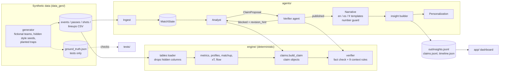

# Architecture

## Data flow

1. `data_gen` writes CSV tables plus `ground_truth.json` (only tests read it; `engine/` and `agents/`
   never import `data_gen` or read ground truth; tests enforce this).
2. `engine.tables.load` reads only observable columns. A single match is loaded with
   `baseline="season"`, so its league comparisons use the season.
3. The orchestrator streams the match one event at a time: Ingest dedups and drops incomplete rows,
   the state store records the event, the Analyst's triggers fire.
4. A trigger produces a claim object via `engine.claims.build_claim` (numbers, evidence IDs,
   scope, game state; no prose).
5. The Verifier recomputes the claim from the events ingested so far and runs the context rules;
   blocked claims go back to the Analyst for revision (attempt + 1) or are dropped.
6. Published claims are rendered from templates in three languages; the number guard checks every
   sentence.
7. The insight builder turns the claim into a timed insight (type, payload, context chip); the
   dashboard maps `insight_type` to a widget and Personalization selects per viewer.

Match time: `clock_sec` is elapsed time and runs through stoppage time, so a match ends after 90:00.
The Analyst's half-time summaries wait for the first-half `half_end` event, `timeline.json` carries
each period's elapsed bounds, and the dashboard turns elapsed time into football time (45+2, 90+4).
Substitutes, cards and fouls are ordinary events and players: no component special-cases them, and
the evidence drawer shows a foul's fouled player and a substitution's incoming player
(`related_player_id`).

## Agents

Plain Python classes in `agents/`, run in-process by `agents.orchestrator.Orchestrator`. No agent
computes a number: numbers come from `engine/` (metrics, claims, verifier); agents decide when to
look, what to claim, how to revise and how to word it from templates.

| Agent | Module | Role |
|---|---|---|
| Ingest | `agents/ingest.py` | deduplicate rows by event_id; drop and report rows missing the fields their type needs (never repaired) |
| Analyst | `agents/analyst.py` | triggers on the stream (kickoff preview, checkpoints, half/full time, momentum swings, threat passes, milestones); proposes plain claims via `engine.claims.build_claim`; revises blocked claims |
| Verifier | `agents/verifier_agent.py` | `engine.verifier` on the claim object, against the season (preview) or the ingested events so far |
| Narrative | `agents/narrative.py` | fills `agents/templates/<lang>.json` (analyst + casual per template_key) with the verified params; number guard |
| Personalization | `agents/personalization.py` | selects from the stream by mode, language, favorite club, player focus, single metric; never regenerates |

## Handoffs

Each handoff is a typed message (`agents/messages.py`) and a structured log record
(`agents/log.py`, one JSON object per action: agent, event, claim_id, attempt, status, rule_ids, ...).

| From -> To | Message | Content |
|---|---|---|
| stream -> Ingest | raw rows | event rows in clock order |
| Ingest -> Orchestrator | `IngestReport` + clean rows | accepted count, duplicate IDs, missing fields per dropped row |
| Orchestrator -> state | `MatchState` | ingested events, clock, score, rolling counters, cooldowns, published, dropped |
| Analyst -> Verifier | `ClaimProposal` | pending claim object, insight_type, trigger event and clock, dataset (match/season), strategy, revision_of, build spec |
| Verifier -> Orchestrator | `VerificationResult` | claim with `verification` filled (status, rule_ids, context_note, revision_hint, attempt) + the verdict details |
| Orchestrator -> Analyst | blocked `VerificationResult` | Analyst returns a revised `ClaimProposal` (attempt + 1) or drops it |
| Orchestrator -> Narrative | published claim | template_key + params |
| Narrative -> Orchestrator | `RenderedText` | language -> tone -> text, number_guard_passed |
| Orchestrator -> consumer | `Published` | final result, text, every attempt's result |

### The revision loop

1. The Analyst's first attempt is plain: the headline number only (`field_tilt.stat`: "NOR hold 76.3%
   field tilt in this spell").
2. The Verifier fact-checks it against the events ingested so far, then runs the context rules. A
   context rule that fires names the params the sentence must carry (`REQUIRES`); when they are
   missing the claim is `blocked` with `revision_hint`, e.g. `{"field_tilt_with_lead": ["box_entries"]}`.
3. The Analyst revises by rule: add game state and box entries (`field_tilt_with_lead`), add shot
   count and xG per shot (`shot_spam`), add the shot count (`small_sample_xg`), split open play and
   set pieces (`set_piece_inflation`), add pass quality (`wide_forward_passes`), add press intensity
   (`ppda_alone`). A fact-check failure is rebuilt from the tables once ("recompute"). Causal,
   red-card-causal and single-match-fatigue claims are dropped, never reworded.
4. The revised claim (attempt 2) is re-verified: now `published_with_context`, with its context_note.
   At most 3 attempts.

### What the Verifier can see

Match and window claims are verified against `MatchState.view()`: the match dataset restricted to
the events ingested so far. A claim can never be backed by an event the stream has not delivered.
The season preview (scope `season`) is verified against the season baseline.

## Requirement -> code

| Requirement (CLAUDE.md / overnight steps) | Where | Checked by |
|---|---|---|
| Math first: an LLM never computes; text from templates | `engine/`, `agents/narrative.py`, `agents/templates/` | `test_agents.py::test_every_template_has_both_tones_and_only_param_numbers`, number guard tests |
| Every insight backed by a claim object | `engine/claims.py`, `contracts/claim.schema.json` | `test_stream.py::test_every_insight_validates`, `test_agents.py::test_every_published_claim_is_valid_and_backed_by_the_past` |
| Every params number equals value or a supporting value | `contracts/checks.py` | `test_contracts.py`, Verifier `value_mismatch` |
| Verify before translating; guard after | `agents/orchestrator.py`, `agents/narrative.py` | `test_translation.py` |
| Two-part Verifier, rules in engine/rules/ | `engine/verifier.py`, `engine/rules/*.py` | `test_verifier.py`, `test_verifier_full.py` (slow) |
| No causal claims from thin data | `rules/causal_claim.py`, `rules/causal_red_card.py`, `rules/single_match_fatigue.py` | `test_verifier.py::test_causal_claims_are_always_blocked`, `test_agents.py::test_causal_claim_is_dropped_not_revised` |
| Synthetic event data only, no tracking claims | `data_gen/`, `engine/tables.py` | `test_engine.py::test_loader_drops_hidden_generator_columns`; pitch note in the dashboard |
| Fictional teams, no trademarks | `data_gen/config.py`, `data_gen/league.py` | `test_full_league.py` (fictional names) |
| No predictions | Analyst triggers describe past and present only | review (no predictive metric exists) |
| Zones from the attacker's point of view | `engine/zones.py` | `test_engine.py::test_zones_match_the_data_dictionary`, soft-lane recovery tests |
| Contracts decouple engine and UI | `agents/insights.py` (semantic `insight_type`), `app/` (widget mapping in components/ and pages/) | `test_stream.py` |
| Engine recovers planted style seeds and traps | `engine/profiles.py`, `engine/matchup.py`, rules | `test_engine.py`, `test_full_league.py`, `test_verifier.py` |
| Effect sizes, Wilson intervals, confidence | `engine/metrics.py`, `engine/profiles.py` | `test_engine_fixtures.py`, `test_engine.py` |
| Season baselines for single matches | `engine/tables.py` | `test_engine.py::test_showcase_uses_season_baseline` |
| Block -> revise -> re-verify with attempts | `agents/analyst.py` (`revise`), `verification.revision_hint` | `test_agents.py::test_raw_field_tilt_claim_blocked_then_republished_with_context` |
| Insight stream runner and latency < 1 s | `agents/stream.py`, `agents/run_match.py` | `test_stream.py::test_latency_under_one_second` |
| Personalization modes | `agents/personalization.py`, `agents/personalize.py` | `test_translation.py` |
| Dashboard: no-build React, local only, every number traced | `app/`, `agents/dashboard_data.py`, `tools/check_dashboard.py` | `test_ui_stack.py`, `test_dashboard_data.py`, `test_number_trace.py`, `test_dashboard.py` (slow, needs Playwright) |
