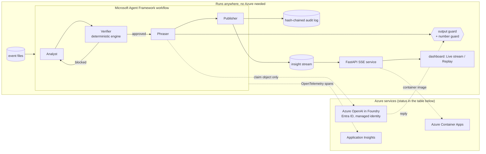

# Azure integration

Optix keeps its core promise with or without Azure: every number is computed and verified by the deterministic engine before any sentence exists, and a model can only reword a claim the Verifier already approved, behind a guard that falls back to the template on any doubt.

## Status

Generated by `python -m agents.azure_status --write` from the files, tests and the live-check report (tests/test_azure_status.py fails if this table drifts). States: **verified live**, **verified by tests**, **verified by CI build/lint**, **built, not verified live**, **not built**, and **by design (file replay)** for a deliberate scope choice: events come from the committed synthetic files, not a live feed.

| Component | Technology | Status | Live check | Evidence | Note |
|---|---|---|---|---|---|
| Agent workflow | Microsoft Agent Framework (agent-framework-core) | **verified by tests** | not applicable | `tests/test_workflow.py` | Analyst, Verifier, Phraser and Publisher executors with a block-and-revise conditional edge; same stream as the direct pipeline. Runs locally, needs no Azure resource. |
| Output guard and template fallback | Applies to any model output | **verified by tests** | not applicable | `tests/test_phraser.py` | Altered or invented numbers, other teams, talk of future results, wrong decimal separator, over-length, wrong language and malformed JSON are rejected and replaced by the template, with a fake model client. |
| Model phrasing client | Azure OpenAI in Azure AI Foundry, Microsoft Entra ID (DefaultAzureCredential) | **verified live** | verified live | `agents/phraser.py` | Calls a chat deployment with the claim object only; the guard above decides what is kept. |
| Phrasing cache | Local files (data/phrasing-cache) | **verified by tests** | not applicable | `tests/test_phraser.py` | Accepted replies keyed by claim hash, deployment and prompt version; re-guarded on replay. Holds guard-accepted model sentences for the showcase claims, used only on the Azure phraser path. |
| Spans for every agent step | OpenTelemetry | **verified by tests** | not applicable | `tests/test_telemetry.py` | Proposal, verdict with rule ids, phraser with guard result, publication; checked with an in-memory exporter. |
| Telemetry export | Azure Monitor / Application Insights | **verified live** | verified live | `agents/telemetry.py`, `infra/main.bicep` | Spans exported to Application Insights by the live check and every export returned SUCCESS; the span count is in docs/azure-live-check.md. |
| Audit log | Append-only JSONL with a hash chain | **verified by tests** | not applicable | `tests/test_audit.py` | Tamper-evident: an edited, removed or reordered record fails verification. |
| Live stream service | FastAPI with server-sent events | **verified by tests** | not applicable | `tests/test_service.py` | Health, matches, the SSE replay at a chosen speed and claim attempts; the dashboard shows Live stream when served by it and Replay otherwise. |
| Container image | Docker (multi-stage, non-root) | **verified by CI build/lint** | not applicable | `Dockerfile`, `docker-compose.yml`, [CI run 39892235299](https://github.com/Malottey1/optix/actions/runs/39892235299) at `a317ae6` | Built by the CI job docker-build (not pushed), and the container answered its health check there. |
| Infrastructure as code | Bicep: Azure Container Apps, Log Analytics, managed identity | **verified by CI build/lint** | not applicable | `infra/main.bicep`, `infra/deploy.md`, [CI run 39892235299](https://github.com/Malottey1/optix/actions/runs/39892235299) at `a317ae6` | Compiled by az bicep build in the CI job bicep-build, parameters too. Never deployed. |
| Event source | Replay of the provided synthetic match files | **by design (file replay)** | not applicable | `service/app.py` | The engine reads the committed synthetic match files and the stream service replays the verified insights at a chosen speed, which keeps results deterministic. A live-feed source such as Azure Event Hubs is not part of this submission. |

Live check: ran, see docs/azure-live-check.md.

Verified deployment: `gpt-4.1-mini` on a Global Standard deployment in France Central, reached with Microsoft Entra ID. The phrasing cache holds its guard-accepted sentences for the showcase claims (docs/live-phrasing-sample.md); the committed UI data stays template-based.

## Where things are

- Phrasing layer and guard: `agents/phraser.py`, `agents/output_guard.py` (docs/ARCHITECTURE.md).
- Workflow: `agents/workflow.py`; run with `python -m agents.run_match --engine workflow`.
- Spans and audit: `agents/telemetry.py`, `agents/audit.py` (`python -m agents.audit verify FILE`).
- Service: `service/app.py` (`uvicorn service.app:app`), dashboard wiring in `web/src/data/SseSource.ts`.
- Container and Bicep: `Dockerfile`, `docker-compose.yml`, `infra/`; deploy steps in `infra/deploy.md`.
- Configuration: `.env.example` (copy to the gitignored `.env`); Entra ID via `az login`, no keys in the repo.
